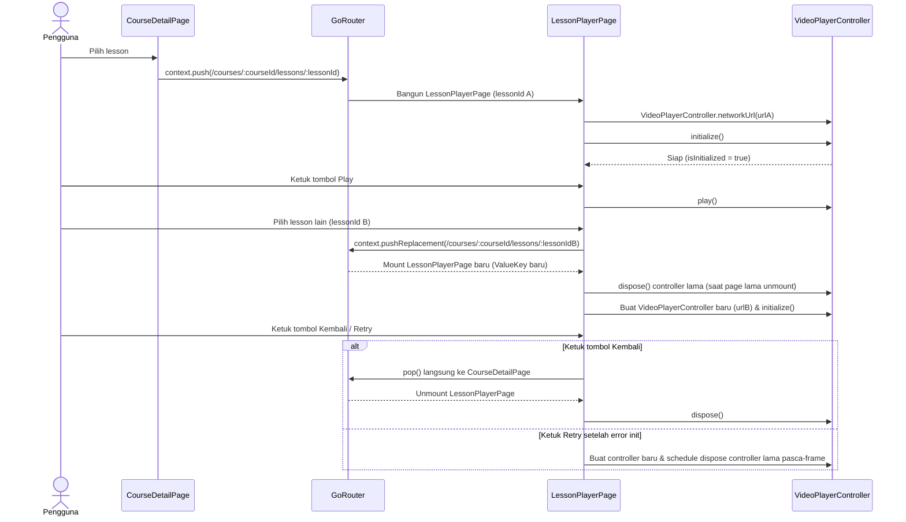

# Dokumentasi Desain Teknis Shain

> Catatan: Folder [`docs/design/`](design/) disiapkan untuk menyimpan tangkapan layar (screenshot) desain Figma.

## (a) Komponen dan Alur Data

```mermaid
flowchart LR
    UI["UI Layer - CourseListPage, CourseDetailPage, LessonPlayerPage"]
    Provider["Riverpod Providers - courseListProvider, courseDetailProvider, courseRepositoryProvider"]
    Repo["Repository - CourseRepository / ApiCourseRepository"]
    Dio["HTTP Client - Dio + ApiConfig"]
    API["Mock / REST API - /courses.json & /courses/{id}.json"]

    UI -->|"ref.watch / ref.invalidate"| Provider
    Provider -->|"getCourses() / getCourseDetail(id)"| Repo
    Repo -->|"GET request"| Dio
    Dio -->|"HTTPS JSON"| API
    API -->|"Response JSON / Error"| Dio
    Dio -->|"List / Map / DioException"| Repo
    Repo -->|"CourseSummary / CourseDetail / AppException"| Provider
    Provider -->|"AsyncValue (loading, data, error)"| UI
```



## (b) Sequence Diagram Pemutaran Video



## (c) Model Data dan Kontrak API

### 1. Model Data

- **`CourseSummary`** ([`lib/features/course/data/course_summary.dart`](../lib/features/course/data/course_summary.dart))
  - `id` (`String`)
  - `title` (`String`)
  - `description` (`String`)
  - `thumbnailUrl` (`String`)
  - `instructor` (`String`)
  - `lessonCount` (`int`)
  - `totalDurationMinutes` (`int`)
- **`CourseDetail`** ([`lib/features/course/data/course_detail.dart`](../lib/features/course/data/course_detail.dart))
  - `id` (`String`), `title` (`String`), `description` (`String`), `thumbnailUrl` (`String`), `instructor` (`String`)
  - `lessons` (`List<Lesson>`)
  - Getter turunan: `lessonCount` (`lessons.length`) dan `totalDurationMinutes` (`(totalSeconds / 60).round()`)
- **`Lesson`** ([`lib/features/course/data/lesson.dart`](../lib/features/course/data/lesson.dart))
  - `id` (`String`)
  - `order` (`int`)
  - `title` (`String`)
  - `durationSeconds` (`int`)
  - `videoUrl` (`String`)
- **`AppException`** ([`lib/core/network/app_exception.dart`](../lib/core/network/app_exception.dart))
  - Kategori: `AppExceptionType.network` (timeout / `connectionError`), `AppExceptionType.server` (`badResponse` + `statusCode`), `AppExceptionType.unknown` (error lainnya / payload null).

### 2. Kontrak Endpoint & Contoh JSON

#### `GET /courses.json` (API asli: `GET /courses`)

```json
[
  {
    "id": "flutter-basic",
    "title": "Flutter Dasar",
    "description": "Belajar membangun antarmuka mobile yang rapi dan mudah digunakan.",
    "thumbnailUrl": "https://example.com/flutter-basic.jpg",
    "instructor": "Budi Santoso",
    "lessonCount": 4,
    "totalDurationMinutes": 25
  }
]
```

#### `GET /courses/{id}.json` (API asli: `GET /courses/{id}`)

```json
{
  "id": "flutter-basic",
  "title": "Flutter Dasar",
  "description": "Belajar membangun antarmuka mobile yang rapi dan mudah digunakan.",
  "thumbnailUrl": "https://example.com/flutter-basic.jpg",
  "instructor": "Budi Santoso",
  "lessons": [
    {
      "id": "flutter-basic-1",
      "order": 1,
      "title": "Pengenalan Widget Dasar",
      "durationSeconds": 180,
      "videoUrl": "https://example.com/videos/flutter-basic-1.mp4"
    },
    {
      "id": "flutter-basic-2",
      "order": 2,
      "title": "Membuat Layout Responsif",
      "durationSeconds": 240,
      "videoUrl": "https://example.com/videos/flutter-basic-2.mp4"
    }
  ]
}
```
